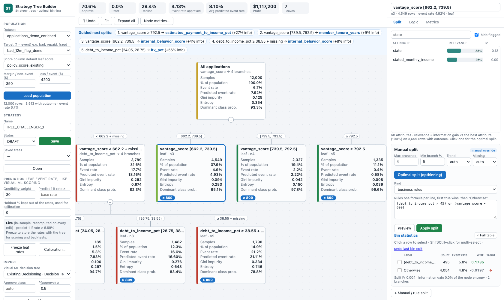

# Business Inference Tree

> **A personal open-source project by Luiz Kauffmann.** It is independent work: not a Dataiku product, and not affiliated with, endorsed by or supported by Dataiku or any other company named in this repository.

Two Dataiku webapps for building **credit strategy trees**, the decision trees risk teams use to turn a score and bureau / application attributes into decisions:

| Webapp | What it is for |
| --- | --- |
| **Strategy Studio** | Hand-built binary strategy trees on a scored population (TRIAD-style).<br>Score adjustments, cut-off decisions, reason codes, pricing tiers and limit multipliers.<br>Live backtest, champion / challenger, exports to decisioning engines (InterConnect, PowerCurve, FICO, Oscilar, Pega, Provenir, Taktile, DMN) and a simulated deployment. |
| **Strategy Tree Builder** (shown in Dataiku as *Business Inferencing Tree*) | An Angoss / Knowledge Studio-style strategy-tree builder.<br>Relevance-ranked attributes, **optimal multi-way splits** (optbinning) and Binning v2-style **manual bin overrides**.<br>Business logic in nodes: calculations, rule splits, formula leaves, **several outputs per leaf** (decision, pricing, segment) with root defaults. Configurable node metrics and **Visual ML decision-tree import**.<br>Model-like **event-rate prediction** per row with calibration. Scales to 1,500+ attributes and can *Send to Studio*. |



## Documentation

| Guide | Contents |
| --- | --- |
| [Installation](docs/installation.md) | Code environment, project library, webapp set-up, managed folders |
| [Strategy Studio](docs/strategy-studio.md) | Screens, nodes, backtest, champion / challenger, export and deploy |
| [Strategy Tree Builder](docs/strategy-tree-builder.md) | Relevance, optimal splits, bin overrides, metrics, Visual ML import, scaling |
| [Logic tab and formula language](docs/logic-and-formulas.md) | Calculations, rule splits, leaf formulas – with a worked example |
| [Event-rate prediction](docs/event-rate-prediction.md) | `tree_proba_1` / `tree_prediction`, credibility weighting, freeze, calibration, backtest |
| [Exports and integrations](docs/exports.md) | Every export format of both apps, Strategy Studio ↔ Tree Builder conversion |
| [Architecture and API](docs/architecture.md) | Modules, routes, data contracts (JSON), folders, output columns |
| [Testing](docs/testing.md) | Synthetic data, engine tests, browser tests |

## How the two apps fit together

```
scored dataset ──► Strategy Tree Builder ──(Send to Studio)──► Strategy Studio ──► engine exports / simulated deploy
      │                │  optbinning splits, formulas,                │  backtest, champion / challenger
      │                │  event-rate prediction                       │
      └────────────────┴──► <input>_tree dataset                      └──► <input>_strategy dataset
```

- Both apps read a Dataiku dataset with attributes, a 0/1 target and a score.
- Both save to the managed folder `decision_strategies`: `strategies/` for Strategy Studio, `trees/` for the Tree Builder.
- Both write a decisions dataset on the input's connection.
- The Tree Builder can reuse the split definitions saved by a Binning v2 webapp in the folder `binning_configs` (optional).

## Quick start

1. Create the code environment, copy `src/` into the project library and create the two standard webapps from `webapp_shells/` ([installation](docs/installation.md)).
2. Open **Strategy Tree Builder**, pick a dataset, the target (1 = event) and the score column, then **Load population**.
3. Click the top-ranked attribute and **Apply split**. Refine the bins (merge / edit boundary / split), add calculations and leaf rules in **Logic**, **Freeze leaf rates** and check **Calibration…**.
4. **Write decisions dataset**, **Download** SQL / Python, or **Send to Studio** and export to your decision engine from **Strategy Studio**.

## Status and scope

- **Personal project.** Designed and built by Luiz Kauffmann. It runs on standard Dataiku features (Python / Flask webapp backends) plus open-source `optbinning` (Apache 2.0), but it is not a packaged or supported Dataiku feature.
- **Illustrative engine exports.** Except DMN 1.3, the decision-engine exports are illustrative mappings of each engine's concepts, not official vendor import formats. Each file says so in its `schemaNote`.
- **Simulated deployment.** It packages the strategy and stores a receipt; no external system is called.
- **Synthetic test data.** The tests and the generator use synthetic data only.

## Repository layout

```
src/strategy_studio/         strategy_engine.py, engine_examples.py, strategy_webapp.py, strategy_ui/
src/strategy_tree_builder/   strategy_tree.py, tree_expr.py, tree_builder_webapp.py, tree_builder_ui/
src/common/                  binning_output.py (writes output datasets on the input's connection)
webapp_shells/               the HTML / CSS / JS / Python tabs of each Dataiku webapp
tests/                       synthetic data generator, engine tests, Playwright browser tests
docs/                        guides and screenshots
```

## Author, licence and trademarks

- **Author:** Luiz Kauffmann ([@Luizkauffmann](https://github.com/Luizkauffmann)). Copyright © 2026 Luiz Kauffmann.
- **Licence:** Apache License 2.0 (see `LICENSE` and `NOTICE`). You may use, modify and redistribute the code under its terms, keeping the copyright and notice.
- **No warranty.** This is not financial, credit-risk or regulatory advice. Validate any strategy, model or export on your own data and under your own governance before using it for real decisions.
- **Trademarks.** Dataiku, Equifax / InterConnect, Experian / PowerCurve, FICO, Oscilar, Pega, Provenir, Taktile and Angoss / Knowledge Studio are trademarks of their respective owners. They are mentioned only to describe compatibility or comparable concepts; no endorsement is implied.
