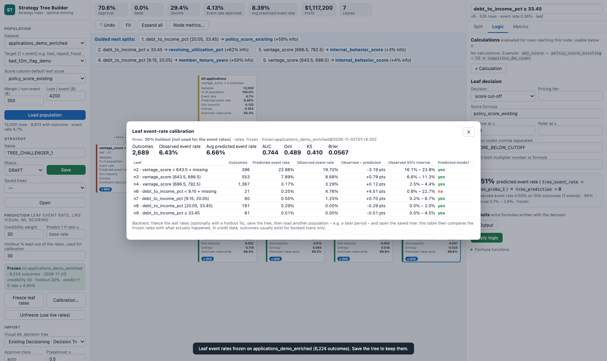

# Event-rate prediction – a model-like forecast per row

Like Dataiku's Visual ML scoring, every row gets **prediction columns**. They come from the observed **event rate** of the leaf it reaches.

**Naming.** The *event* is whatever the target codes as **1**: default or bad in a PD model, repayment in a probability-of-repay model, fraud, churn, prepayment, and so on. So the app speaks of *event rate*, *events* and *non-events*, not bad rate or PD. Internally, the metric keys keep their original names (`bad_rate`, `bads`), and the frozen rates are stored under `pd_model` / `pd_settings` in the tree JSON, so older trees still load.

**Where the leaf event rate shows up**
- In the leaf's *Logic* tab: *7.1 % predicted event rate → tree_prediction = 1*, with the observed event rate, the number of outcomes and the 95 % interval.
- On the node cards (metric **Predicted event rate**).
- In the KPI strip (**Avg predicted event rate**).
- In the written dataset and the exports.

### Output columns

| Column | Meaning |
| --- | --- |
| `tree_proba_1` | Predicted probability of the event (target = 1) of the row's leaf, as in a Visual ML scoring |
| `tree_proba_0` | 1 − `tree_proba_1` |
| `tree_prediction` | 1 if `tree_proba_1` ≥ the threshold, else 0 |
| `tree_event_rate` | Predicted event rate of the leaf (= `tree_proba_1`, smoothed) |
| `tree_event_rate_raw` | Observed event rate of the leaf, before smoothing |
| `tree_event_rate_lower`, `tree_event_rate_upper` | 95 % Wilson interval of the observed event rate |
| `tree_event_n_known` | Number of outcomes the leaf rate is based on |
| `tree_event_rate_source` | `frozen:<dataset>@<date>`, or `live in-sample:<dataset>` |

### Settings (sidebar → Prediction)

- **Credibility weight m** (default 30): small leaves are shrunk toward their parent, top-down, with rate = (events + m × parent rate) / (outcomes + m).
  - `0` = the raw leaf event rate.
  - A leaf with thousands of outcomes barely moves; a leaf with 40 outcomes moves a lot.
- **Predict 1 if rate ≥** (default: the overall event rate): the threshold for `tree_prediction`.
- **Holdout %** (default 0; 30 is recommended for a review): a fixed random share of rows (seed 42) that is kept out of the rates and used to measure calibration.

### Live vs frozen

- **Live** (default): the rates are recomputed from the loaded data on every edit. They are *in-sample*: optimistic, because the splits were chosen on the same data.
- **Freeze leaf rates**: stores each leaf's rate in the tree, together with the dataset, target, number of outcomes, settings and date. Save the tree to keep them.
  - A frozen tree scores any population, including one **without an outcome**.
  - The **SQL and Python exports** then also return `tree_proba_1` and `tree_prediction` (production scoring).
- **Stale**: changing a split, cut or calculation after freezing marks the rates *stale*. The app falls back to live rates until you freeze again. Leaf decisions, tiers and outputs do not affect the rates.

### Calibration and backtest

**Calibration…** opens a per-leaf comparison of predicted vs observed event rate on:
- the **holdout** rows, if a holdout % is set;
- all rows of another dataset, for a frozen tree opened on a different population;
- otherwise all rows, flagged *in-sample*.

It shows each leaf's observed 95 % interval and whether the predicted rate falls inside it. It also reports **AUC, Gini, KS and Brier** for `tree_proba_1`.

**Backtest recipe:**
1. Set Holdout % = 30.
2. **Freeze leaf rates**, then **Save**.
3. Load a later population, e.g. a more recent period, and **Open** the saved tree.
4. Open **Calibration…** to compare the frozen rates with what happened.
5. **Write decisions dataset** to keep `tree_proba_1` / `tree_prediction` / `tree_event_rate` for further analysis, e.g. in a Visual ML evaluation or a dashboard.

### Reading the numbers

- **Event rate vs predicted event rate.** *Event rate* on a card uses rows with a known outcome only. *Predicted event rate* is the average over **all** rows of the node. In credit data, outcomes exist for booked loans only, so the root's predicted rate is higher than its observed rate: declined applicants sit in riskier leaves.
- **Small leaves.** A holdout calibration shows why the credibility weight matters: in one test, a small high-risk leaf was predicted at 16 % and observed at 5 % on the holdout. Check `tree_event_n_known` and the interval before using a leaf rate as a forecast.
- **Selected outcomes.** When outcomes are observed only for part of the population (booked loans), the rates of leaves that are mostly declines are measured on few, selected rows. Use reject inference (e.g. parcelling, or an outcome for every applicant such as `bad_latent_synthetic` in the synthetic test data) before treating them as through-the-door rates.
- **Segment-level forecast.** A leaf rate is a segment-level forecast, not a calibrated model per applicant. For an individual probability, use a model's score as the *Score column*, or bring the model's probability in as a column.
- **Economics.** *Margin / non-event* and *Loss / event* assume the event is the costly outcome, e.g. default. For a probability-of-repay target, read the profit KPI accordingly, or code the target so that 1 = the costly event.

## How the rates are computed

- **Top-down.** For every node, `pd(node) = (events + m × pd(parent)) / (outcomes + m)`, with the root at its raw rate. The leaves' values are the predictions.
- **95 % interval.** A Wilson interval on the leaf's raw rate.
- **Threshold.** `tree_prediction` = 1 when `tree_proba_1` ≥ the threshold. The default threshold is the root's raw event rate on the development rows.
- **Holdout.** The holdout split is `RandomState(seed).rand(n) < holdout_pct / 100` (seed 42). It is fixed for a given dataset row order.
- **Freezing** stores in the tree:
  - the leaf rates and settings;
  - dataset, target, number of outcomes and date;
  - a **signature** of the tree structure (ids, splits, calculations).
  When the signature no longer matches, the frozen rates are *stale* and live rates are used.
- **Calibration metrics.** Per leaf: predicted vs observed rate, with the observed Wilson interval. Overall: AUC (rank-based), Gini = 2·AUC − 1, KS, Brier score.
