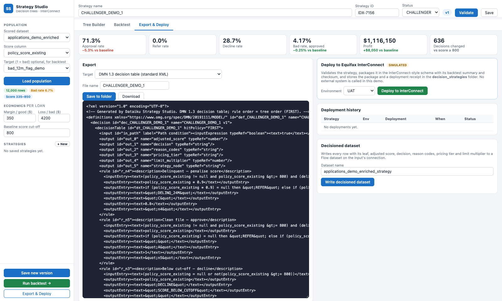

# Exports and integrations

## Strategy Studio

Export & Deploy → *Target*. **Save to folder** writes `decision_strategies/exports/<NAME>_v<version>.<target>.<ext>`; **Download** saves the same file locally.

| Target | File | Status | What it contains |
| --- | --- | --- | --- |
| Equifax InterConnect | `.interconnect.json` | Illustrative | Inputs with data source (scorecard / bureau / application). `decisionFlow` of CONDITION and OUTCOME nodes, with operators, missing-value route and actions: ADJUST_SCORE, SET_DECISION (score cut-off or fixed), SET_REASON_CODES, SET_PRICING_TIER, SET_CREDIT_LIMIT_MULTIPLIER. Output definitions, backtest summary, SHA-256 checksum. |
| Experian PowerCurve Strategy Management | `.powercurve.json` | Illustrative | Data dictionary: characteristics in upper snake case, with data type, data area (SCORE / BUREAU / APPLICATION) and source column. Decision tree: split nodes with a condition branch and *Otherwise*, flag for where missing values go; terminal nodes point to decision setters. Decision setters: ADJUSTED_SCORE expression, DECISION range table (missing → REFER), REASON_CODES, PRICING_TIER, CREDIT_LIMIT_MULTIPLIER, STRATEGY_NODE_ID. Champion / challenger role, backtest summary, checksum. |
| FICO Platform decision tree | `.fico.json` | Mock | Nested partitions and actions |
| Oscilar workflow rules | `.oscilar.json` | Example | First-match rule set, one rule per outcome. Path condition in JS-style expressions; actions set the adjusted score and decision, add reason codes, set tier and limit, and tag the node. |
| Pega decision table | `.pega.json` | Example | One row per outcome. Conditions in Pega expression style (`.VantageScore`, `@isBlank`, `@if`). Returns `.AdjustedScore`, `.Decision`, `.ReasonCodes`, `.PricingTier`, `.LimitMultiplier`, `.StrategyNode`; an *otherwise* row → REFER. `Data-Credit-Application` is a placeholder class. |
| Provenir decision tree | `.provenir.json` | Example | Nested BRANCH nodes (*match* / *no match*, missing-value routing); OUTCOME nodes with score adjustment, score bands, reason codes, tier, limit |
| Taktile decision flow | `.taktile.json` | Example | Decision table (first hit) assigning each row to a segment, then Python assignments per segment |
| DMN 1.3 decision table | `.dmn.dmn` | **Standard** | OMG DMN 1.3 XML, FIRST hit policy, FEEL expressions, one rule per outcome. Read by DMN tools such as Camunda, Trisotech, Red Hat Decision Manager and IBM ODM. |
| Generic strategy JSON | `.generic.json` | Native | `{"type": "dataiku_strategy_tree", "meta", "tree"}` |
| SQL CASE expressions | `.sql.sql` | Native | `SELECT t.*, CASE … END AS strategy_leaf, adjusted_score, strategy_decision, pricing_tier FROM input_table t` |
| Python function | `.python.py` | Native | `decide(row)` returning node, decision, adjusted score, reason codes, tier, limit |

**Illustrative / example formats.** These show how a strategy maps onto each engine's concepts. They are **not official vendor import specifications**, and the first field (`schemaNote`) says so. Map the inputs to the engine's data model before a real hand-off.

**How the engine examples are built.** Oscilar, Pega, Provenir, Taktile and DMN all use one flattening: **one rule per outcome**, whose condition is the chain of splits on the path, with the missing-value routing applied.
- The rules are mutually exclusive, so first-hit and unique-hit evaluation agree.
- The Taktile output, executed as Python, reproduces Strategy Studio's outcome, adjusted score and decision on every test row.
- Category values are compared as text in these examples (`1.0` and `1` differ), whereas Strategy Studio compares them canonically.

**Re-import.** *Advanced JSON* accepts a generic export, an InterConnect export, a PowerCurve export or a bare tree. It rebuilds the strategy, with identical decisions.

**Engine module.** The engine examples live in `engine_examples.py`. `strategy_engine.py` imports them if available; if the module fails to import, only the example targets disappear.

## Strategy Tree Builder

Sidebar → Export & deploy → *Format* → **Download**.

| Format | Content |
| --- | --- |
| Strategy tree JSON | `{"type": "dataiku_strategy_tree_v2", "version": 2, "meta", "tree", "checksum"}`: full fidelity, including calculations, formulas, prediction settings and frozen leaf rates. **Save** additionally stores the display settings. |
| SQL CASE | One `CASE` per output column (`tree_leaf`, `tree_score`, `tree_decision`, `reason_codes`, `pricing_tier`, `limit_multiplier`). Calculations are inlined; missing comparisons are false. With frozen leaf rates, it also returns `tree_proba_1` and `tree_prediction`. |
| Python function | `decide(row)` returns node, decision, score, reason codes, tier, limit, outputs and calcs; with frozen leaf rates, also `proba_1` and `prediction` |
| Strategy Studio JSON | The converted binary tree with the list of conversion issues |

The SQL and Python exports reproduce the app's decisions, and the frozen event rates and predictions, on every test row.

### Send to Studio (conversion rules)

| Tree Builder | Strategy Studio |
| --- | --- |
| Numeric split with cuts `c1 … ck` | Chain of `x < c1`, `x < c2`, … binary splits |
| Category groups | Chain of `in` splits; unlisted categories go to the last group. An issue is listed if they followed another branch. |
| Missing → branch *k* / own branch | `missing = yes` on the matching split / a leading `is_missing` split |
| Leaf decision, cut-offs, reason codes, tier | Copied |
| Constant limit multiplier | Copied |
| Node calculations, rule splits, score formulas, limit formulas | **Not representable.** Listed as issues; after confirmation, a simplified tree is written. A rule split is replaced by its *Otherwise* branch. |

The strategy is written to `decision_strategies/strategies/<NAME>.json` and opens in Strategy Studio's list. Leaf event rates are not carried over: Strategy Studio has no prediction columns.
