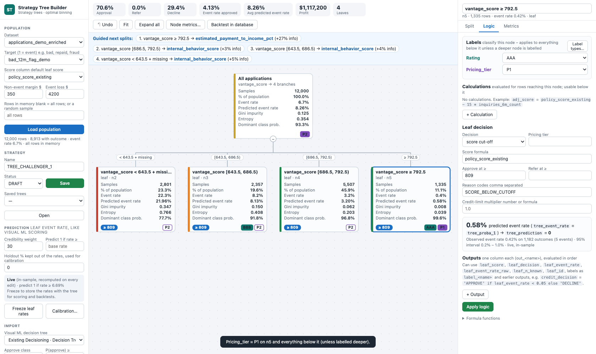

# Labels & risk examples

**Labels** turn the tree's own if / else structure into a classification. Look at a node's statistics, decide "this branch is BBB" or "this segment is pricing tier P2", and pick it from a list.

A label then travels everywhere the tree goes:
- the decisions dataset;
- the SQL and Python exports;
- *Send to Studio* and every Strategy Studio export.

Use labels for judgement-based classifications: risk ratings, pricing tiers, segments, test cells, collections queues, adverse-action groups…

Labels are **additive**: score cut-offs, fixed decisions, outputs, formulas and the leaf *Pricing tier* field all keep working as before, and can read the labels.



## How labels work

| Concept | Behaviour |
| --- | --- |
| **Label type** | A name plus an ordered list of values, e.g. `Rating` = `AAA, AA, A, BBB, BB, B, CCC`. Defined in *Logic → Labels → Label types…*. The default is `Rating` = `AAA, AA, A, BBB, BB, B`. Names use letters, digits or _ (`Rating`, `Pricing_tier`, `Segment`). |
| **Setting a label** | Select **any node** (split or leaf) → *Logic* → *Labels* → pick a value. It applies immediately, with no *Apply logic* needed. |
| **Inheritance** | A node's label applies to **every row below it**, unless a deeper node sets its own value. Label a whole branch once, then override the exceptions. |
| **On the tree** | Each card shows a badge per label type. **Solid** = set on this node; **outlined** = inherited (hover shows from which node). |
| **Output column** | `label_<name>` (e.g. `label_Rating`), one value per row, empty where no label applies |
| **In formulas** | Leaf score, outputs and the credit-limit formula can read `label_<name>`, e.g. `0.099 if label_Pricing_tier == 'P1' else 0.149` |
| **Exports** | SQL (`label_<name>` columns), Python `decide(row)` (`labels`), Strategy Tree JSON |
| **Strategy Studio** | *Send to Studio* resolves the inheritance and stores each leaf's labels. Studio shows them on the outcome and writes `label_<name>` in its decisioned dataset.<br>Its exports carry them too: SQL / Python columns, InterConnect `SET_LABEL` actions, PowerCurve `LABEL_<NAME>` assignments, the Oscilar / Pega / Provenir / Taktile examples and DMN outputs. |
| **Renaming / removing** | *Label types…*: renaming a type renames it on every node; removing a type (after confirmation) removes its values. |

## Step by step: your first label

1. Load the population and build a split, e.g. the optimal split on `vantage_score`.
2. Click the **root** → *Logic* → *Labels* → **Label types…**. Keep `Rating` and edit its values if needed (e.g. add `CCC`), then **Apply**.
3. Click a branch whose statistics you like → *Rating* → **A**. Its card, and every card below it, shows **A**.
4. Click a weaker child inside that branch → *Rating* → **BBB**. Only that child changes.
5. **Write decisions dataset**: the new column `label_Rating` holds the rating of every row. **Download → SQL CASE** has the same column.
6. **Save** the tree. Label types and values are saved with it.

## Example 1 – Risk-rating grid (score band × debt-to-income)

**Goal:** a rating for every applicant, decided by analysts looking at each node's event rate. Numbers below come from a 12,000-application credit demo set (target `bad_12m_flag_demo`); `tests/labels_examples.py` builds these exact trees.

**Tree** (optimal split on `vantage_score`, then `debt_to_income_pct` inside the middle bands):

| Node | Rows | Label set on the node | Resulting rating |
| --- | --- | --- | --- |
| Score < 643.5 + missing (leaf, DECLINE) | 2,801 | `CCC` | CCC |
| Score [643.5, 686.5) (split) | 2,357 | `BB` | inherited by its children |
| ├ DTI < 36 | | `BBB` (override) | BBB |
| ├ DTI [36, 45) | | – | **BB** (inherited) |
| └ DTI ≥ 45 + missing (REFER) | | `B` (override) | B |
| Score [686.5, 792.5) (split) | 5,507 | `BBB` | inherited |
| ├ DTI < 36 | | `A` (override) | A |
| └ DTI ≥ 36 + missing | | – | **BBB** (inherited) |
| Score ≥ 792.5 (leaf, APPROVE) | 1,335 | `AAA` | AAA |

**Result on the demo data** (event rate on rows with an outcome):

| Rating | Share | Event rate | Approval |
| --- | --- | --- | --- |
| AAA | 11.1 % | 0.42 % | 100 % |
| A | 31.9 % | 2.72 % | 100 % |
| BBB | 24.8 % | 5.52 % | 99.5 % |
| BB | 5.6 % | 9.09 % | 88.7 % |
| B | 3.2 % | 9.81 % | 0 % (referred) |
| CCC | 23.3 % | 22.3 % | 0 % (declined) |

**How to read it**
- **Rank-ordering.** The ratings rank risk cleanly. **BB and B are close** (9.1 % vs 9.8 %), so either merge them or check the *Calibration…* intervals before keeping two grades.
- **AA is empty.** No node earns AA yet. Split the AAA leaf further if you need it.
- **SQL export.** It reproduces `label_Rating` on 100 % of rows, so the rating can be computed in the warehouse.

## Example 2 – Pricing tiers driving APR and loan amount

**Goal:** classify branches into pricing tiers by judgement, and let one formula price every leaf from the tier.

1. *Label types…* → add `Pricing_tier` = `P1, P2, P3, P4`.
2. On the tree of Example 1, set `Pricing_tier` on:
   - **Score ≥ 792.5** → `P1`;
   - **Score [686.5, 792.5)** → `P2`, and its child **DTI < 36** → `P1`;
   - **Score [643.5, 686.5)** → `P3`;
   - **Score < 643.5** → `P4`.
3. Root → *Logic* → **Default outputs** (applied to every leaf):

| Name | Formula |
| --- | --- |
| `apr` | `0.099 if label_Pricing_tier == 'P1' else (0.129 if label_Pricing_tier == 'P2' else (0.169 if label_Pricing_tier == 'P3' else 0.219))` |
| `max_amount` | `0 if leaf_decision == 'DECLINE' else round(stated_monthly_income * (4 if label_Pricing_tier in ['P1', 'P2'] else 2), 0)` |

**Result**
- **Tier mix:** P1 43 %, P2 14 %, P3 20 %, P4 23 %.
- **APR:** `out_apr` = 9.9 % / 12.9 % / 16.9 % / 21.9 % by tier.
- **Amount:** `out_max_amount` is positive for the 76 % of rows that are not declined.

To re-price, change the APR grid once at the root; to move a branch to another tier, change one label. Both the label and the APR are in the decisions dataset and the SQL export.

## Example 3 – Policy segments with a business-rule split

**Goal:** route applications into policy segments that downstream teams recognise, and decide differently per segment.

Root → *Split* → **+ Manual / rule split** (first true rule wins):

```
delinquencies_24m_count > 0 or collections_count > 0
thin_file_flag == 1
vantage_score >= 760 and debt_to_income_pct < 36
```

| Branch | Label `Segment` | Decision | Result (event rate · approval) |
| --- | --- | --- | --- |
| Derogatory | `DEROG` | DECLINE, reason `DELINQ_OR_COLLECTION` | 16.0 % · 0 % |
| Thin file | `THIN_FILE` | *from an output* `credit_decision` = `'APPROVE' if member_tenure_years >= 3 and leaf_event_rate < 0.08 else 'REFER'` | 12.7 % · 0 % (all referred: the segment's rate is above 8 %) |
| Prime | `PRIME` | APPROVE | 1.2 % · 100 % |
| Otherwise | `NEAR_PRIME` | score cut-off 780 | 5.5 % · 93 % |

`label_Segment` gives operations a stable segment code even if the rules change later.

**In Strategy Studio.** *Send to Studio* converts these three rules into a chain of yes / no splits (rule 1 ? DEROG : rule 2 ? THIN_FILE : rule 3 ? PRIME : NEAR_PRIME), so every segment and its `label_Segment` arrive; Studio routes 100 % of rows like the Tree Builder. Only the *Thin file* decision changes: a decision *from an output* is not representable and becomes REFER (listed before sending).

## Example 4 – Champion / challenger test cells

**Goal:** test a lower cut-off in one score band and keep track of which rows were in the test.

1. *Label types…* → add `Test_cell` = `CHAMPION, TEST_A`.
2. **Root** → `Test_cell` = `CHAMPION`, inherited by everything.
3. **Score [643.5, 686.5)** → `Test_cell` = `TEST_A`. In that band, lower the cut-offs: DTI < 36 from 760 to **740**, DTI [36, 45) from 780 to **760**.

**Result**

| Cell | Rows | Approval | Event rate of approved |
| --- | --- | --- | --- |
| CHAMPION | 9,643 | 70.9 % | 2.62 % |
| TEST_A | 2,357 | 82.1 % | 7.79 % |

The test cell approves 11 points more but at three times the event rate. **Backtest in database** and **Calibration…** show whether that holds on the full table and the holdout. In production, `label_Test_cell` in the SQL output tags every decision with its cell for monitoring.

## More ideas

| Label type | Values | Typical use |
| --- | --- | --- |
| `Collections_queue` | `SOFT, STANDARD, PRIORITY` | Early-delinquency treatment by branch of a behaviour tree |
| `Limit_band` | `L1, L2, L3` | Read in the credit-limit formula: `1.2 if label_Limit_band == 'L1' else 0.8` |
| `Review_reason` | `INCOME_CHECK, FRAUD_CHECK` | Manual-review routing for REFER leaves |
| `Policy_version` | `2026Q4, 2027Q1` | Audit trail of which version of a branch decided |

## Good practice

- **Label on statistics, check on data.** Set labels where node statistics support them, then verify with *Calibration…*, *Backtest in database* and the event rate by label in the written dataset.
- **Keep the value list ordered** from best to worst. The list documents the scale for reviewers and validators.
- **Protected characteristics.** Do not label on protected characteristics or their proxies. Labels feed pricing and decisions, so they fall under fair-lending review like any other strategy rule.
- **Freeze before export.** Freeze leaf event rates before exporting when labels or outputs use `leaf_event_rate`.
