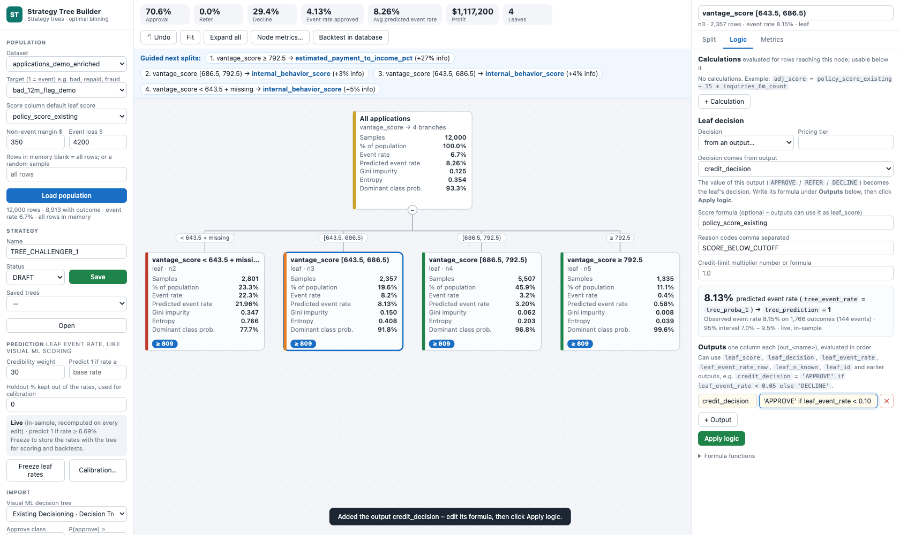
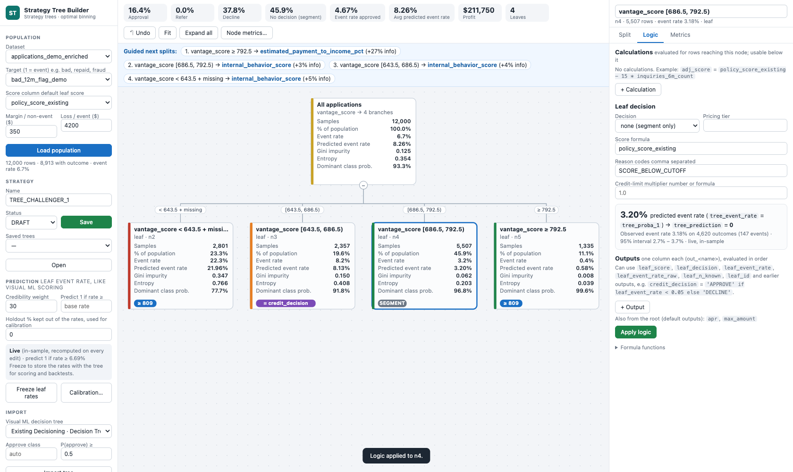

# Logic tab and formula language

Select a node, open **Logic**, edit, then click **Apply logic**. Every edit is re-evaluated on the whole population straight away.

### Order of evaluation for each row

1. **Calculations** of the root, then of each node on the row's path, top-down. A calculation exists only for rows that reach its node, and every node *below* can use it like a column. Each one is also written to the output as `calc_<name>`.
2. **Splits** route the row: numeric cuts, category groups or **rules** (first true rule wins, last branch = *Otherwise*). A split can use a calculation as its variable.
3. At the **leaf**, in this order:
   - **score formula** (blank = the *Score column*), which gives `tree_score`;
   - **decision**: *score cut-off* gives APPROVE if score ≥ *Approve at*, REFER if ≥ *Refer at*, otherwise DECLINE (a missing score gives REFER); or a fixed APPROVE / REFER / DECLINE; or *from an output*; or *none (segment only)*;
   - **reason codes** and **pricing tier** (fixed text);
   - the leaf's **outputs**, in order, then the root's **default outputs**, each written as `out_<name>`;
   - **credit-limit multiplier** (number or formula, blank = 1.0);
   - **predicted event rate** (`tree_proba_1` / `tree_event_rate`, see [Event-rate prediction](event-rate-prediction.md)).

Formulas use a safe language:
- column and calculation names, numbers, `+ - * / **`, comparisons;
- `and` / `or` / `not`, `in [...]`, `a if condition else b`;
- the functions `min`, `max`, `abs`, `round`, `floor`, `ceil`, `log`, `exp`, `sqrt`, `clip`, `where`, `coalesce`, `isnull`, `notnull`, `between` and `col('name with spaces')`.

A comparison with a missing value is false. The same formula runs in the app, in the SQL export and in the Python export.

### Worked example

It runs on the synthetic data from `tests/make_demo_data.py`; `tests/wiki_examples.py` builds this exact tree and checks that the SQL and Python exports match the app on every row.

**Root node → Calculations**

| Name | Formula | Meaning |
| --- | --- | --- |
| `adj_score` | `policy_score_existing - 15 * inquiries_6m_count` | Score penalised 15 points per recent inquiry |
| `dti_stress` | `debt_to_income_pct * 1.1 + 5` | Stressed debt-to-income (+10 % and +5 points) |
| `loan_to_income` | `requested_amount / max(stated_monthly_income * 12, 1)` | Loan amount vs annual income (no division by 0) |

**Root node → Split → + Manual / rule split** (one rule per line):

```
delinquencies_24m_count > 0 or collections_count > 0
thin_file_flag == 1 and member_tenure_years < 2
```

This gives three branches: *Derogatory*, *Thin file, new member* and *Otherwise* (clean file).

**Leaves of the rule split**

| Leaf | Decision | Reason codes |
| --- | --- | --- |
| Derogatory | DECLINE | `DELINQ_OR_COLLECTION` |
| Thin file, new member | REFER | `THIN_FILE` |

**Clean-file branch → numeric split on the calculation** `dti_stress`, cuts `35, 50` (missing → last branch). Its three leaves:

| Leaf | Score formula | Approve at / Refer at | Tier | Credit-limit multiplier | Outputs |
| --- | --- | --- | --- | --- | --- |
| Low DTI (< 35) | `adj_score` | 760 / 740 | A | `clip(1.5 - dti_stress / 100, 0.5, 1.2)` | `apr` = `0.199 if vantage_score < 640 else 0.149`; `max_amount` = `round(stated_monthly_income * 3, 0)` |
| Mid DTI [35, 50) | `where(revolving_utilization_pct > 80, adj_score - 20, adj_score)` | 780 / 760 | B, reason `HIGH_UTIL` | `0.8` | – |
| High DTI ≥ 50 | `adj_score - 30` | 800 / – | C, reason `HIGH_DTI` | `0.6 if loan_to_income > 0.3 else 0.8` | – |

**Result columns for one approved applicant:**
- `tree_leaf` = the *Low DTI* leaf, `tree_score` = 801, `tree_decision` = APPROVE;
- `limit_multiplier` = 1.155, `out_apr` = 0.149, `out_max_amount` = 15,581;
- `calc_adj_score` = 801, `calc_dti_stress` = 34.48;
- plus `tree_proba_1` / `tree_prediction` / `tree_event_rate`.

The SQL and Python exports of this tree reproduce 100 % of its decisions.

**Tips**
- A formula can only use calculations defined on the same node or above it. **Validate** reports unknown names.
- *Send to Studio* converts rule splits made of simple comparisons (`and` / `or` / `not`, `in`, `between`, `isnull`) into Strategy Studio yes / no splits. Calculations, formulas and rules with arithmetic cannot be represented: *Send to Studio* lists them, suggests computing them as dataset columns first, and asks you to confirm a simplified version.

## Multiple outputs per leaf: decision, pricing, segments

A leaf can produce **several outputs**: a credit decision, a pricing grade, an APR, a maximum amount, a fraud check. Outputs can be built from the leaf's own results, and the decision itself can come from an output.

### Leaf decision modes

| Decision | `tree_decision` | Use |
| --- | --- | --- |
| **score cut-off** | APPROVE / REFER / DECLINE from the score formula and cut-offs | Classic strategy tree |
| **APPROVE / REFER / DECLINE** | Fixed | Policy leaves, knock-outs |
| **from an output…** | The value of the chosen output, upper-cased; a missing value gives REFER | Decision written as a formula, e.g. on the leaf's event rate |
| **none (segment only)** | Empty | Segmentation or pricing trees whose decision is made elsewhere; prediction-only trees |

The KPI strip adds **No decision (segment)** when some rows have no decision. Approval-based KPIs count APPROVE only.

**Using "from an output…", step by step**
1. On a leaf, set **Decision = from an output…**.
2. If the leaf has no outputs yet, the app adds a ready-made output and selects it in **Decision comes from output**:
   `credit_decision` = `'APPROVE' if leaf_event_rate < 0.10 else ('REFER' if leaf_event_rate < 0.15 else 'DECLINE')`.
3. Edit that formula under **Outputs**, add more outputs if you like (e.g. `apr`, `max_amount`), and click **Apply logic**.
4. The card shows `= credit_decision`, and every row of the leaf gets `tree_decision` = its `out_credit_decision`.
5. In this mode the *Score formula* is optional: outputs can use its value as `leaf_score`.



### Leaf values usable in formulas

| Name | Value | Usable in |
| --- | --- | --- |
| `leaf_id` | Id of the leaf, e.g. `n11` | Score, outputs, limit |
| `leaf_event_rate` | Predicted event rate of the leaf (`tree_event_rate`): frozen if frozen, else live | Score, outputs, limit |
| `leaf_event_rate_raw`, `leaf_n_known` | Observed event rate, number of outcomes | Score, outputs, limit |
| `leaf_score` | Result of the score formula | Outputs, limit |
| `leaf_decision` | The leaf's decision. With *from an output*, available after that output. | Outputs, limit |
| Earlier outputs | By name, e.g. `credit_decision` | Later outputs, limit |

### Default outputs for every leaf

Select the **root** → *Logic* → **Default outputs**. They are evaluated in every leaf **after** the leaf's own outputs, so they can read the leaf's decision. A leaf output with the same name overrides the default for that leaf. Each leaf's *Logic* tab lists the defaults it inherits.

**Order in a leaf**
1. score formula;
2. decision (cut-off / fixed);
3. the leaf's own outputs, in order;
4. default outputs;
5. credit-limit formula.

### Example: decision + pricing + segment

Root → **Default outputs** (pricing for every leaf):

| Name | Formula |
| --- | --- |
| `risk_grade` | `'A' if leaf_event_rate < 0.03 else ('B' if leaf_event_rate < 0.06 else 'C')` |
| `apr` | `round(0.099 + 1.2 * leaf_event_rate, 4)` |
| `max_amount` | `0 if leaf_decision == 'DECLINE' else round(stated_monthly_income * 3, 0)` |

Leaf *vantage_score [620, 700)* → **Decision = from an output…** `credit_decision`:

| Name | Formula |
| --- | --- |
| `credit_decision` | `'APPROVE' if leaf_event_rate < 0.05 and leaf_score >= 760 else ('REFER' if leaf_event_rate < 0.08 else 'DECLINE')` |
| `apr` (overrides the default) | `0.149 if credit_decision == 'APPROVE' else None` |

- **Credit-limit multiplier** of that leaf: `1.1 if leaf_decision == 'APPROVE' else 0`.
- **Leaf *vantage_score ≥ 700*** → Decision = **none (segment only)**, with output `segment` = `'PRIME' if leaf_score >= 800 else leaf_id`.

**Result.** Every row gets `tree_decision` plus `out_risk_grade`, `out_apr`, `out_max_amount`, `out_credit_decision` and `out_segment`, each filled where the leaf defines it.

**Validation.** `tests/outputs_test.py` builds this tree; the SQL and Python exports reproduce every one of these columns on 100 % of rows, with live and with frozen leaf rates.

### Notes

- **Exports.**
  - The SQL export now has one `out_<name>` column per output.
  - Leaf values are inlined.
  - `leaf_event_rate` is embedded as a constant per leaf. The header comment says whether these are frozen rates or live in-sample rates; freeze them before using an export in production.
- **Strategy Studio** has no outputs, no *none* and no *from an output*. *Send to Studio* lists them; those leaves become REFER and their outputs are dropped.
- **Formula language.** Strings can be compared and returned (`'APPROVE'`), but not concatenated: `+` is numeric.
- **`round()`** rounds half away from zero, as SQL does, so the app and the exports agree on ties.



## Formula language reference

| Element | Syntax |
| --- | --- |
| Names | Column names and calculation names; `col('name with spaces')` for any other column name |
| Literals | Numbers, `'text'` / `"text"`, `True`, `False`, `None` |
| Arithmetic | `+  -  *  /  //  %  **` on numbers (division by zero gives missing; no string concatenation) |
| Comparisons | `<  <=  >  >=  ==  !=`, chained comparisons (`300 <= x < 600`) |
| Logic | `and`, `or`, `not` |
| Membership | `x in ['CA', 'NY']`, `x not in [...]` |
| Conditional | `a if condition else b` |
| Leaf values | `leaf_id`, `leaf_event_rate`, `leaf_event_rate_raw`, `leaf_n_known` (score, outputs, limit); `leaf_score`, `leaf_decision`, earlier outputs (outputs, limit) |
| Functions | `min`, `max` (element-wise, several arguments), `abs`, `round(x, digits)` (half away from zero, as in SQL), `floor`, `ceil`, `log`, `exp`, `sqrt`, `clip(x, low, high)`, `where(cond, a, b)`, `coalesce(a, b, …)`, `isnull`, `notnull`, `between(x, low, high)` (inclusive) |

**Missing values**
- Any comparison with a missing value is false, so a rule on a missing attribute falls through to the next rule.
- `isnull` / `coalesce` handle missing values explicitly.
- Arithmetic with a missing value gives missing; a missing score at a cut-off leaf gives REFER.

**Safety.** Formulas are parsed with Python's `ast` and only the elements above are allowed: no attribute access, subscripts, lambdas, comprehensions or imports. Unknown names are reported by **Validate**.

**One formula, three runtimes.** Every formula is evaluated:
- vectorised over pandas in the app;
- translated to **SQL** (`CASE WHEN`, `COALESCE`, `GREATEST` / `LEAST`, `NULLIF` for division) for the SQL export;
- translated to row-level **Python** for the `decide(row)` export.

The test suite checks that the three agree on every row.

