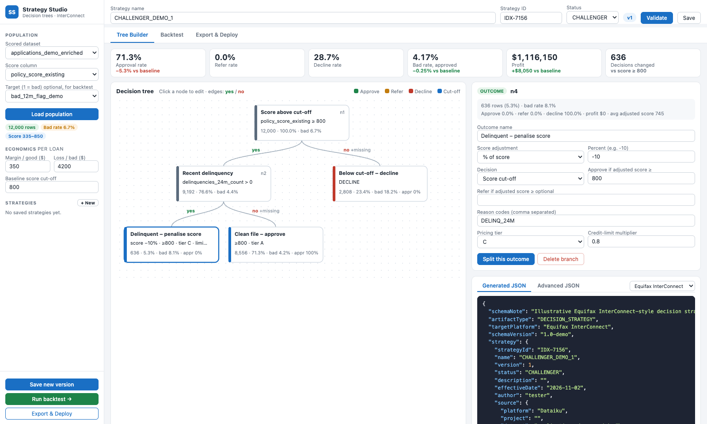
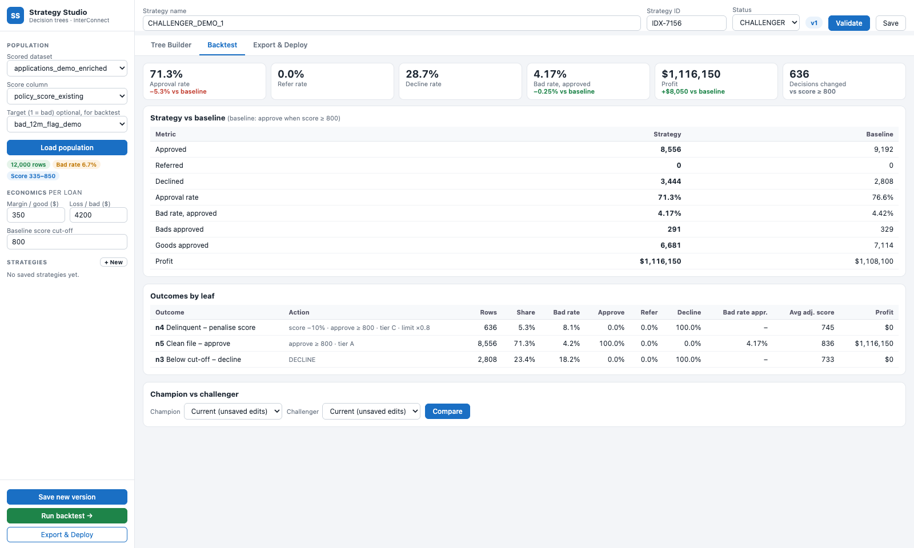
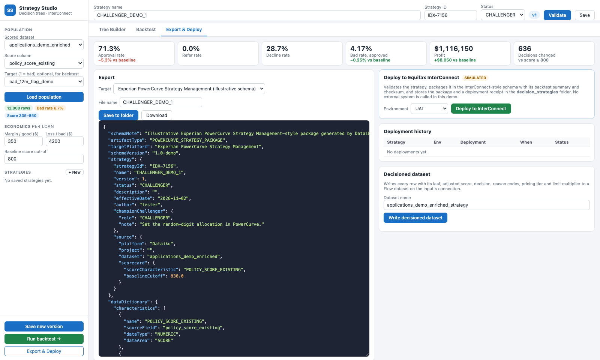

# Strategy Studio – user guide

Strategy Studio builds **manual decision trees** (TRIAD-style: designed by hand, not trained) on top of a scored population:
- start from the score;
- branch on bureau and application attributes;
- at each outcome, adjust the score and set the decision, reason codes, pricing tier and credit-limit multiplier.

Every edit is validated and backtested live. The strategy can be exported to a decisioning engine or deployed (simulated).

## Screen layout

| Area | Content |
| --- | --- |
| **Header** | *Strategy name*, *Strategy ID*, *Status* (DRAFT / CHAMPION / CHALLENGER), version badge, **Validate**, **Save** |
| **Sidebar – Population** | *Scored dataset*, *Score column*, *Target (1 = bad)* (optional, for the backtest), **Load population**, chips (rows, bad rate, score range) |
| **Sidebar – Economics per loan** | *Margin / good ($)*, *Loss / bad ($)*, *Baseline score cut-off* |
| **Sidebar – Strategies** | Saved strategies (click to open) and **+ New** (templates) |
| **Sidebar – footer** | **Save new version**, **Run backtest →**, **Export & Deploy** |
| **KPI strip** | Approval, refer and decline rates, bad rate of approved, profit, decisions changed, each with its difference from the baseline (approve when score ≥ baseline cut-off) |
| **Tabs** | **Tree Builder**, **Backtest**, **Export & Deploy** |

## 1. Load a population

Select a scored dataset, the score column and optionally the target, then **Load population**.
- If the dataset carries scorecard metadata (`scorecard_cutoff`, `avg_margin_per_good`, `avg_loss_per_bad`), the economics and the baseline cut-off are pre-filled.
- Otherwise, enter margin, loss and cut-off yourself. Without them, the Profit tile shows "–".

## 2. Tree Builder tab

- The canvas shows the tree top-down.
  - **Split nodes** show their condition; **outcomes** show their action.
  - Every node shows rows, share of the population and bad rate.
- Edges are labelled **yes** / **no**, with *+missing* on the branch that receives missing values.
- Outcome colours: green Approve, amber Refer, red Decline, blue score cut-off.
- Click a node to edit it in the right panel.

**Templates (+ New)**
- *Score + delinquency override*:
  - score ≥ cut-off → `delinquencies_24m_count > 0` → score −10 %, tier C, limit ×0.8;
  - clean files → tier A;
  - below the cut-off → declined.
- *Score cut-off only*: the baseline champion.

### Condition (split) nodes

| Field | Notes |
| --- | --- |
| Node name | Label shown in the tree and the JSON |
| Variable | Grouped as **Scorecard** (score, `points_*`), **Bureau** (bureau-type attributes), **Application**. The hint shows type, range / median, top values and % missing. |
| Operator | Numeric: ≥ > ≤ < = ≠ between, is missing. Categorical: = ≠ in list, not in list, is missing. |
| Value | Number, or comma-separated values for *in list*; *between* has From / To |
| Missing values go to | Yes or No branch (default No) |

Buttons: **Convert to outcome**, **Delete branch** (replaces the sub-tree with one outcome).

### Outcome (leaf) nodes

| Field | Behaviour |
| --- | --- |
| Score adjustment | None · % of score (−10 → score × 0.9) · Points (−25) · Set score to |
| Decision | **Score cut-off**: APPROVE if adjusted score ≥ *Approve if*, REFER if ≥ *Refer if* (optional), else DECLINE. Or a fixed **Approve / Refer / Decline**. Rows without a score are referred. |
| Reason codes | Comma separated, upper-cased |
| Pricing tier | A–E |
| Credit-limit multiplier | e.g. 0.8 |

**Split this outcome** turns the outcome into a condition with two copies of its actions underneath. That is how the tree grows: multi-way splits are chained binary splits. For optimal multi-way splits, formulas or 1,500+ attributes, use the [Strategy Tree Builder](strategy-tree-builder.md) and *Send to Studio*.

### JSON panel

- **Generated JSON** updates on every edit in the selected format: Equifax InterConnect, Experian PowerCurve, FICO (mock) or Generic.
- **Advanced JSON** lets you edit the tree as JSON (generic, InterConnect or PowerCurve format) and **Apply advanced JSON**.
- **Validate** lists errors (red, they block the backtest and deploy) and warnings (amber). Click one to jump to its node.

## 3. Save and version

- **Save** writes `decision_strategies/strategies/<NAME>.json` (the name is upper-cased).
- **Save new version** increments the version and keeps the history: who, when and a note.
- The **Strategy ID** is carried into exports and deployment receipts.

## 4. Backtest tab

| Section | Content |
| --- | --- |
| **Strategy vs baseline** | Approved / referred / declined, approval rate, bad rate of approved, bads and goods approved, profit |
| **Outcomes by leaf** | Rows, share, bad rate, approve / refer / decline %, bad rate approved, average adjusted score, profit per outcome |
| **Champion vs challenger** | Pick two saved strategies (or *Current*) → KPIs side by side and the **swap set**, e.g. APPROVE → DECLINE rows and their bad rate |

Profit = margin × goods approved − loss × bads approved. Referrals are not counted as approved.

## 5. Export & Deploy tab

| Card | Purpose |
| --- | --- |
| **Export** | Pick a *Target* format and a *File name*. **Save to folder** → `decision_strategies/exports/<NAME>_v<version>.<target>.<ext>`; **Download** saves it locally. All formats: see [Exports](exports.md). |
| **Deploy to Equifax InterConnect – SIMULATED** | Pick an *Environment* (Sandbox / UAT / Production) → **Deploy to InterConnect**. Validates the strategy and packages it with its backtest summary and a SHA-256 checksum. Stores the package and a receipt (deployment ID, environment, version, author, KPIs) in `decision_strategies/deployments/`. No external system is called. |
| **Deployment history** | Last deployments read from the folder |
| **Decisioned dataset** | **Write decisioned dataset** (default `<input>_strategy`): every row plus `strategy_leaf`, `strategy_path`, `adjusted_score`, `strategy_decision`, `reason_codes`, `pricing_tier`, `limit_multiplier` |

## Evaluation rules (reference)

- **Missing values**: rows whose variable is missing follow the node's *missing* branch (default *no*), except for the `is_missing` operator itself.
- **Categories** are compared canonically: `1`, `1.0` and `"1"` are equal.
- **`==` / `!=`** compare numerically when both sides are numeric, otherwise as text.
- **Score adjustment**:
  - `pct`: score × (1 + value / 100);
  - `points`: score + value;
  - `set`: value.
- **Cut-off decision**: APPROVE if adjusted ≥ approve_at, REFER if adjusted ≥ refer_at, otherwise DECLINE. A missing score gives REFER.
