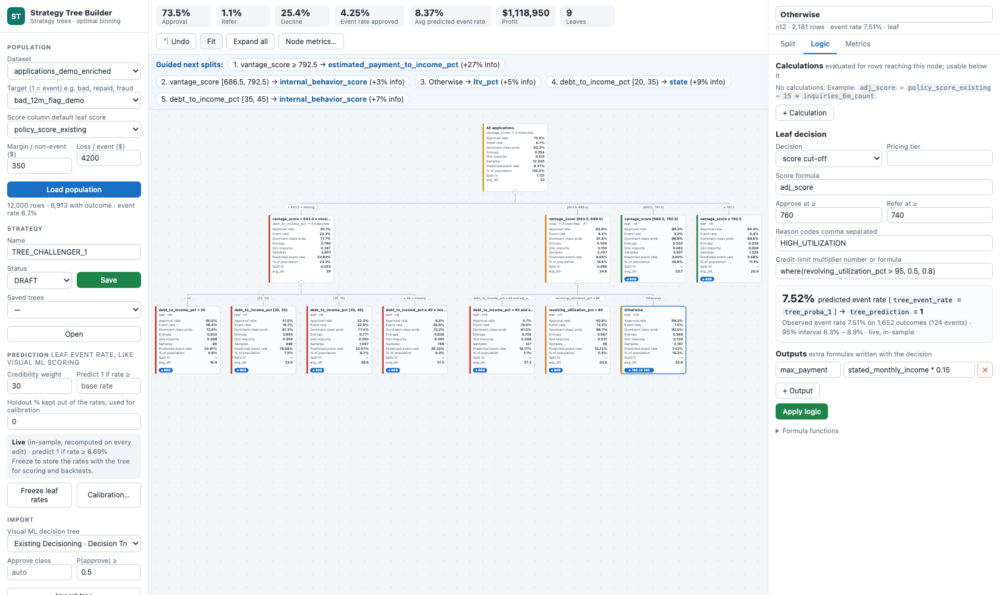
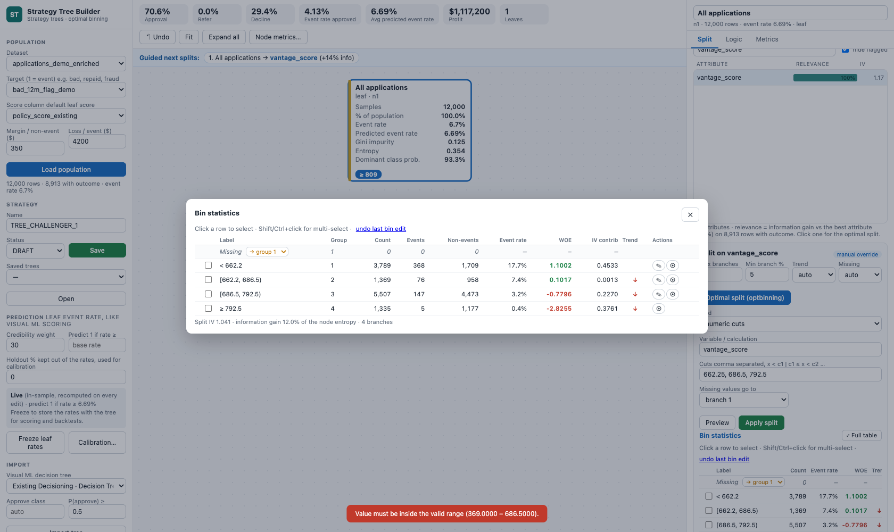
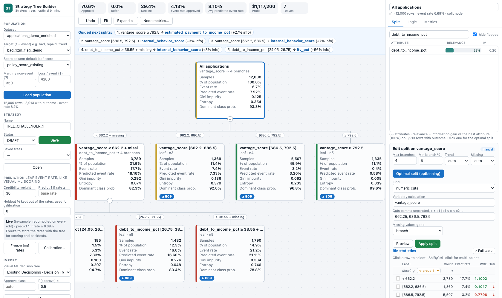
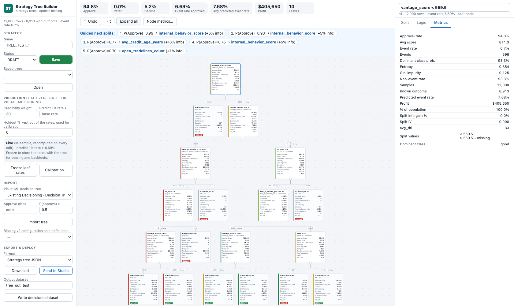
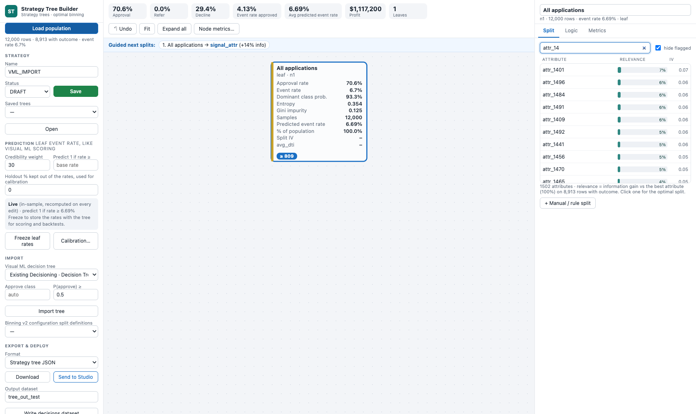

# Strategy Tree Builder – user guide

Strategy Tree Builder (shown in Dataiku as *Business Inferencing Tree*) combines strategy-tree decisioning with **optimal binning**. You grow a tree node by node:
- attributes are ranked for the selected node;
- an optimal multi-way split is proposed, which you can override bin by bin;
- business logic is added in the nodes;
- every row gets a decision **and** a predicted event rate.

## Requirements covered

| Requirement | How it is met |
| --- | --- |
| **Relevance scores and guided splitting** | *Split* tab: every attribute ranked for the selected node with **Relevance %** (information gain in that node; best attribute = 100 %), IV and quality flags. The **Guided next splits** bar ranks the leaves by the information the best next split would add (outcomes × information gain) and names the attribute; one click opens it. |
| **Strategy-tree functionality: formulas, calculations, business logic in nodes** | *Logic* tab: node **calculations** usable by every node below, **rule splits** (first true rule wins), leaf **score / credit-limit / output formulas**, written in a safe formula language. See [Logic tab and formula language](logic-and-formulas.md). |
| **Multi-split and layer flexibility** | Any node can have **any number of branches**: numeric cuts, category groups or rules. Each node of a layer is split independently, and the same variable can be split again deeper. Missing values and unlisted categories follow a chosen branch or get their own. |
| **Leaf and node metrics, persistently displayed** | Configurable metrics on every card: • samples, % of population, known outcomes, events, event / non-event rate; • **Gini impurity**, **entropy**, **dominant class probability**, predicted event rate; • average score, approval rate, profit, split IV / information gain, split values. Plus **custom metrics** (an aggregation of any formula). The selection is saved with the tree and remembered in the browser. |
| **Visual ML Lab integration** | *Import → Visual ML decision tree* rebuilds a lab or saved decision-tree model as an editable strategy tree. |
| **Performance and scaling (1,500+ attributes)** | Pre-binned attributes, so ranking 1,500 attributes in a node takes ≈ 0.05 s. Virtualised attribute list, debounced search. D3 canvas with viewport culling, memoised cards and collapsible sub-trees. |

## Sidebar

| Input | Notes |
| --- | --- |
| Dataset | Any table with attributes, a target and ideally a score. Up to 200k rows are used for relevance (sampled above). |
| Target (1 = event) | 0/1 outcome: bad / default, repaid, fraud… Empty = unknown (e.g. declined applications). |
| Score column | Default leaf score for cut-off decisions. The starter tree approves at the 30th percentile. |
| Margin / non-event, Loss / event | Economics for the profit KPI: margin × non-events approved − loss × events approved |
| Strategy name / Status, **Save**, Saved trees / **Open** | Saved and versioned in `decision_strategies/trees` (`trees/history/<NAME>_v<n>.json`) |
| Prediction | Credibility weight, threshold, holdout %, **Freeze leaf rates**, **Calibration…**. See [Event-rate prediction](event-rate-prediction.md). |
| Import | **Visual ML decision tree** (approve class + P(approve) threshold); **Binning v2 configuration** (offers saved split definitions) |
| Export & deploy | Format (tree JSON · SQL CASE · Python · Strategy Studio JSON), **Download**, **Send to Studio**, **Write decisions dataset** |

## Split tab

1. **Select a node.** All attributes are ranked for the rows in that node.
   - **Search** is debounced.
   - **Hide flagged** removes attributes flagged as outcome-window, ID-like, constant, date, decision-output or suspicious.
2. **Click an attribute.** **optbinning** (constraint-programming solver) finds the optimal multi-way split *inside that node*. Options:
   - *Max branches* (2–12) and *Min branch %*;
   - *Trend*: auto, ascending, descending, peak, valley or none;
   - *Missing*: auto (own branch when ≥ 2 % of known rows are missing), own branch, similar risk or worst risk.
3. Or **Use saved binning**: the cut-offs / category groups and missing treatment of a Binning v2 configuration become the split.
4. Or **+ Manual / rule split**: one formula per line; the first true rule wins, then *Otherwise*.
5. **Preview** shows the bin statistics; **Apply split** creates one leaf per branch. Each leaf inherits the parent's decision settings.

Numeric cuts follow the optbinning convention `x < c1 | c1 ≤ x < c2 | … | x ≥ ck`. Categorical groups list values per line; *Unlisted categories go to* routes the rest.

### Manual bin overrides (Binning v2-style)

After an optimal split, a saved configuration or **Preview**, the **Bin statistics** table lists one row per bin plus a **Missing** row:
- Count, Events, Non-events and Event rate;
- **WOE** = ln(%events / %non-events) and **IV contrib**;
- **Trend** (↑ / ↓ vs the previous bin).

**⤢ Full table** opens every column in a wide window. For a split already in the tree, select the node and click **✎ Edit this split (bins)**.

| Action | Numeric | Categorical | Business rules |
| --- | --- | --- | --- |
| Click / Shift / Ctrl+click → **Merge N bins** | Adjacent bins only | Any groups, including *Other* | Rules joined with `or` |
| ✎ | **Edit boundary**: current value and valid range between the neighbouring cuts; values outside are refused | Edit the group's categories | Edit the formula |
| ⊕ | **Split the bin** (default cut = the bin's median) | Move ticked categories to a new group | Add a rule after this one |
| Missing row | **own group** or **→ group k** | same | – |

Each edit refreshes the statistics, labels the split *manual override* and can be reverted with **undo last bin edit**. When you apply an edited split:
- **Same number of branches**: the **sub-trees below are kept**, and child names generated from the old cuts are updated.
- **Different number of branches**: you confirm before the sub-trees are replaced by leaves.

## Logic tab

Calculations, leaf decision (score cut-off or fixed decision), score formula, cut-offs, reason codes, pricing tier, credit-limit formula and extra outputs. The leaf box shows the predicted event rate. Full guide and worked example: [Logic tab and formula language](logic-and-formulas.md).

## Metrics tab and *Node metrics…*

- The **Metrics** tab lists every metric of the selected node.
- **Node metrics…** (toolbar) chooses which metrics the cards show and defines **custom metrics**: name · aggregation (mean, sum, min, max, median, std, rate, count) · formula. For example `avg_dti` · mean · `debt_to_income_pct`, or `thin_rate` · rate · `thin_file_flag == 1`.

| Metric | Definition |
| --- | --- |
| Samples, % of population | Rows reaching the node |
| Known outcome, Events | Rows with a 0/1 target; rows with target = 1 |
| Event rate / Non-event rate | Events / known outcomes, and its complement |
| Gini impurity | 2 p (1 − p) |
| Entropy | −p log₂ p − (1 − p) log₂(1 − p) |
| Dominant class prob. | max(p, 1 − p) |
| Predicted event rate | Average `tree_proba_1` over all rows of the node |
| Avg score, Approval rate, Profit | From the leaf decisions |
| Split IV, Split info gain %, Split values | For split nodes |

## Visual ML import

**What it reads.** *Import → Visual ML decision tree* lists the decision-tree models of the project's Visual ML analyses and saved models. A random forest is imported through its first tree.

**What it rebuilds.**
- **Numeric thresholds** are converted back to raw units. Several un-scaling candidates are tried (raw, avg/std, avg/std after imputation, min/max); the one that matches the model's own node sample counts wins, and the threshold is snapped to the midpoint between adjacent data values.
- **Dummy-encoded categories** and missing-value routing are restored.
- **Leaf decisions** come from the class probability: the approve class plus the P(approve) threshold.

**How to check it.** The import message reports the largest leaf-share gap between the data and the model.
- On the test data, the imported tree reproduces the model's decision on 100 % of rows.
- Other preprocessings (impact coding, hashing, derived features) are reported as not supported.

## Performance and scaling

- **Pre-binning.** Every candidate attribute is coded once into ≤ 30 fine classes (`uint8`). Ranking all attributes for a node is then a few vectorised bincounts: ≈ 0.05 s for 1,500 attributes × 12k rows. On very large data, relevance uses a 200k-row sample.
- **Attribute list.** Virtualised (only visible rows are in the DOM), with a debounced search.
- **Tree canvas.** D3 v7 with viewport culling (only visible cards are drawn), memoised cards, collapsible sub-trees and fewer details when zoomed out.
- **optbinning start-up.** The import is warmed up in the background, so the first optimal split does not wait about a minute.

## Outputs

| Output | Content |
| --- | --- |
| **Save** | `decision_strategies/trees/<NAME>.json` (+ history). Includes the display settings, the frozen leaf rates and the prediction settings. |
| **Write decisions dataset** (`<input>_tree`) | Input columns, plus: • `tree_leaf`, `tree_path`, `tree_score`, `tree_decision`; • `reason_codes`, `pricing_tier`, `limit_multiplier`; • `out_<name>`, `calc_<name>`; • `tree_proba_1`, `tree_proba_0`, `tree_prediction`, `tree_event_rate*` |
| **Download** | Tree JSON · SQL CASE · Python `decide(row)` · Strategy Studio JSON. See [Exports](exports.md). |
| **Send to Studio** | Converted to Strategy Studio's binary tree in `decision_strategies/strategies/`. Lists what cannot be converted and asks first. |

## Limitations

- **Rows with an outcome.** Relevance, IV and event rates use rows with a known outcome only. In credit data, that usually means booked loans.
- **Fine classes.** Relevance % ranks attributes on fine classes; the split IV in the bin table is the honest measure of a split.
- **Visual ML import scope.** Single decision trees (and the first tree of a forest) with numeric and dummy-encoded features only.
